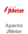
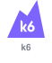
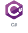
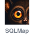
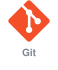

<p align="center">
  
</p>

<h4 align="center">Software Developer · QA Automation Engineer · Cybersecurity Enthusiast · Apache JMeter Contributor</h4>

<p align="center">
  
  &nbsp;
  <a href="https://gitranks.com/profile/rebelwithoutacause"></a>
</p>

---


### I'm a software developer and QA automation engineer. I hold certifications in **QA Automation Engineering** and **Cyber Security & Ethical Hacking**. I care about software quality, clean code, problem-solving and building reliable applications.

- ### 💻 **Software development**: building applications and tools, and writing maintainable, well-tested code
- ### 🧪 **Test automation & QA**: manual and automated testing, unit testing, API testing, bug reporting and QA documentation
- ### 🌍 **Open source**: contributing to [Apache JMeter](https://github.com/apache/jmeter), the open-source load and performance testing tool
- ### 🛡️ **Cybersecurity**: ethical hacking, virtualization and learning how systems work under the hood

### This is where I upload my projects, automation tasks, testing work and everything else from my IT journey.

---

<table>
<tr>
<td align="center" valign="top" colspan="2" width="276">
<p><b>QA &amp; Testing Tools</b></p>
<a href="https://www.selenium.dev/"></a>
<a href="https://www.postman.com/"></a>
<a href="https://swagger.io/"></a>
<a href="https://www.atlassian.com/software/jira"></a><br>
<a href="https://clickup.com/"></a>
<a href="https://trello.com/"></a>
<a href="https://jmeter.apache.org/"></a>
<a href="https://k6.io/"></a><br>
<a href="https://logrocket.com/"></a>
<a href="https://learn.microsoft.com/en-us/dotnet/core/testing/"></a>
<a href="https://stryker-mutator.io/"></a>
</td>
<td align="center" valign="top" colspan="2" width="276">
<p><b>Program&shy;ming Languages</b></p>
<br>
<a href="https://learn.microsoft.com/en-us/dotnet/csharp/"></a>
<a href="https://developer.mozilla.org/en-US/docs/Web/JavaScript"></a>
<a href="https://en.wikipedia.org/wiki/SQL"></a><br>
<a href="https://developer.mozilla.org/en-US/docs/Web/HTML"></a>
<a href="https://developer.mozilla.org/en-US/docs/Web/CSS"></a>
</td>
<td align="center" valign="top" colspan="2" width="276">
<p><b>Cyber&shy;security Tools</b></p>
<br>
<a href="https://nmap.org/"></a>
<a href="https://hashcat.net/hashcat/#gh-light-mode-only"></a><a href="https://hashcat.net/hashcat/#gh-dark-mode-only"></a>
<a href="https://sqlmap.org/"></a>
<a href="https://www.openwall.com/john/"></a><br>
<a href="https://github.com/laramies/theHarvester"></a>
<a href="https://github.com/SpecterOps/BloodHound"></a>
<a href="https://www.tenable.com/products/nessus"></a>
</td>
</tr>
<tr></tr>
<tr>
<td align="center" valign="top" colspan="2" width="276">
<p><b>Develop&shy;ment &amp; DevOps Tools</b></p>
<a href="https://git-scm.com/"></a>
<a href="https://github.com/#gh-light-mode-only"></a><a href="https://github.com/#gh-dark-mode-only"></a>
<a href="https://www.docker.com/"></a>
<a href="https://github.com/features/actions"></a>
</td>
<td align="center" valign="top" colspan="2" width="276">
<p><b>Virtual&shy;ization</b></p>
<a href="https://www.virtualbox.org/"></a>
</td>
<td align="center" valign="top" colspan="2" width="276">
<p><b>Oper&shy;ating Systems</b></p>
<a href="https://www.microsoft.com/windows"></a>
<a href="https://www.kernel.org/"></a>
</td>
</tr>
<tr></tr>
<tr>
<td align="center" valign="top" colspan="3" width="414">
<p><b>Data&shy;bases</b></p>
<a href="https://en.wikipedia.org/wiki/SQL"></a>
<a href="https://www.mysql.com/"></a>
</td>
<td align="center" valign="top" colspan="3" width="414">
<p><b>AI Tools</b></p>
<a href="https://www.anthropic.com/claude-code"></a>
<a href="https://lovable.dev/"></a>
<a href="https://bolt.new"></a>
<a href="https://suno.com/#gh-light-mode-only"></a><a href="https://suno.com/#gh-dark-mode-only"></a>
</td>
</tr>
</table>

---

<p align="center">
  
</p>

<p align="center">
  <a href="https://raw.githubusercontent.com/rebelwithoutacause/rebelwithoutacause/output/space-invaders.svg">
    
  </a>
</p>

---

<div align="center">

# Support Me

### ☕ Enjoying my projects? Help fuel the next one! 🚀

### Every contribution goes straight into learning, building new tools and giving back to open source.

</div>

<div align="center">

### 🏦 IBAN

<h1>

```text
BG75STSA93000029979791
```

</h1>

</div>

<div align="center">

### Thank you for being awesome! 🙌

</div>
